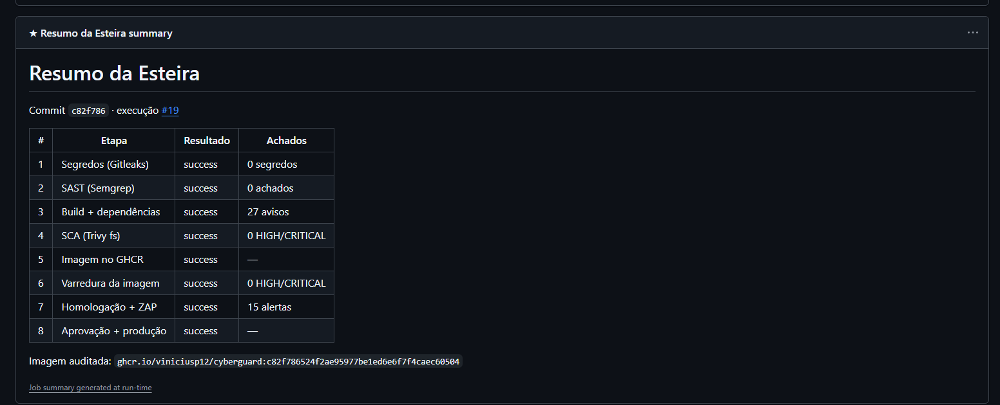

# Hackudinhos

[](https://github.com/viniciusp12/CyberGuard/actions/workflows/devsecops.yml)

Projeto acadêmico do Challenge da Faculdade de Defesa Cibernética, em parceria
com a Leroy Merlin. São duas frentes que se completam:

- **o site** explica os golpes digitais do cotidiano brasileiro, em aberto e sem login;
- **a plataforma** treina o reflexo de reconhecê-los, com módulos, pontuação e ranking.

## Equipe

| Integrante | RM |
|---|---|
| Vinícius Pinheiro Olivetti | 98255 |
| Eduardo José Araujo Santos | 564584 |
| Pedro Frommer Furlani | 564137 |

## No ar

| Ambiente | Endereço |
|---|---|
| Jogo (produção) | https://cyber-guard-jogo.vercel.app |
| Site | https://cyber-guard-site.vercel.app |
| API | https://cyber-guard-api.vercel.app |
| Imagem de contêiner | `ghcr.io/viniciusp12/cyberguard:<sha>` |

---

## Estrutura

Monorepo pnpm + turbo.

| Pacote | O que é | Stack |
|---|---|---|
| `apps/site` | O site público | Next 15 · Tailwind 3 · estático |
| `apps/jogo` | Front da plataforma gamificada | Next 16 · Tailwind 4 |
| `apps/api` | API da plataforma | NestJS 11 · Prisma · PostgreSQL |
| `packages/shared` | Engine de pontuação, schemas e o conteúdo dos módulos | TypeScript · Zod · Vitest |

Site e jogo têm **identidades visuais diferentes de propósito**: o site é
registro técnico institucional, a plataforma é pixel art. Uma explica, a outra
treina — e cada linguagem serve ao seu fim. Isso está documentado em detalhe em
`Contexto Claude/contexto.md`.

---

## Como rodar

Requer Node 24 (veja `.nvmrc`) e pnpm.

```bash
corepack enable && pnpm install
```

O site sobe sozinho, sem configurar nada:

```bash
pnpm --filter site dev
```

A plataforma precisa de banco e variáveis. Copie os exemplos e preencha:

```bash
cp apps/api/.env.example apps/api/.env && cp apps/jogo/.env.example apps/jogo/.env.local
```

Depois, com o banco de pé:

```bash
pnpm --filter api exec prisma migrate deploy
```

Ou só a plataforma:

```bash
pnpm --filter jogo dev
```

E então tudo junto:

```bash
pnpm dev
```

| Serviço | Endereço local |
|---|---|
| Site | `http://localhost:3000` |
| Plataforma | `http://localhost:3000` |
| API | `http://localhost:3003` |

Site e plataforma pedem a mesma porta. Rodando isolados, cada um fica na 3000;
com `pnpm dev`, o Next move o segundo a subir para a **3001** e avisa no
terminal qual foi. A porta da API vem de `apps/jogo/.env.example`.

---

## Verificação

```bash
pnpm typecheck && pnpm build && pnpm audit --prod
```

Os três devem passar limpos. O `audit` reporta **zero** — se voltar a acusar,
os overrides ficam em `pnpm-workspace.yaml`.

---

## Deploy

**Três projetos na Vercel**, todos apontando para este repositório, mudando só
o Root Directory:

| Projeto | Root Directory | Variáveis |
|---|---|---|
| site | `apps/site` | `NEXT_PUBLIC_JOGO_URL` (opcional) |
| jogo | `apps/jogo` | `API_ORIGIN` |
| api | `apps/api` | `DATABASE_URL`, `DIRECT_URL`, `JWT_SECRET`, `NODE_ENV`, `CORS_ORIGIN` |

O front do jogo fala com a API por **rewrite do Next**, feito no servidor.
O navegador enxerga tudo na mesma origem, e é isso que faz o cookie de sessão
(`SameSite=Lax`) funcionar. Não há requisição cross-origin.

O banco é PostgreSQL no Supabase. Use a string do **pooler** (porta 6543) em
`DATABASE_URL` e a **direta** (5432) em `DIRECT_URL` — a explicação completa
está em `apps/api/.env.example`.

A API roda como Serverless Function pelo handler em `apps/api/api/index.ts`.
O `src/main.ts` continua existindo para rodar em servidor tradicional; os dois
compartilham o mesmo `AppModule`.

---

## Esteira DevSecOps

Pipeline de 8 etapas em GitHub Actions
([`.github/workflows/devsecops.yml`](.github/workflows/devsecops.yml)), rodando
a cada push na `main`. Segurança é verificada em cada etapa, não no fim.

```
push (main)
   │
   ▼
[1 Gitleaks] → [2 Semgrep] → [3 Build] → [4 Trivy fs]
                                              │
   ┌──────────────────────────────────────────┘
   ▼
[5 Docker → GHCR] → [6 Trivy image] → [7 Homologação + ZAP]
                                              │
                                     ⏸ aprovação humana
                                              ▼
                                      [8 Deploy produção]
                                              │
                                      [★ Resumo] (sempre)
```

| # | Etapa | Ferramenta | Objetivo | Barra quando | Relatório |
|---|---|---|---|---|---|
| 1 | Segredos | Gitleaks 8.21.2 | Credencial no código ou no histórico | qualquer segredo | [`relatorio-01-gitleaks`](https://github.com/viniciusp12/CyberGuard/actions/runs/41374909847/artifacts/13111110751) |
| 2 | SAST | Semgrep 1.95.0 | Padrão inseguro no código | qualquer achado | [`relatorio-02-semgrep`](https://github.com/viniciusp12/CyberGuard/actions/runs/41374909847/artifacts/13110268823) |
| 3 | Build | pnpm + turbo | Build reprodutível, testes, artefato | build ou teste falha | [`relatorio-03-build`](https://github.com/viniciusp12/CyberGuard/actions/runs/41374909847/artifacts/13110687776) |
| 4 | SCA | Trivy fs | CVE nas dependências | HIGH/CRITICAL | [`relatorio-04-trivy-sca`](https://github.com/viniciusp12/CyberGuard/actions/runs/41374909847/artifacts/13110054407) |
| 5 | Imagem | Docker + GHCR | Publicar imagem pelo SHA | build ou push falha | [`relatorio-05-docker-build`](https://github.com/viniciusp12/CyberGuard/actions/runs/41374909847/artifacts/13111380006) |
| 6 | Scan da imagem | Trivy image | CVE na imagem publicada | HIGH/CRITICAL com correção | [`relatorio-06-trivy-image`](https://github.com/viniciusp12/CyberGuard/actions/runs/41374909847/artifacts/13111096676) |
| 7 | DAST | OWASP ZAP | Falha visível só rodando | informativo | [`relatorio-07-homologacao-zap`](https://github.com/viniciusp12/CyberGuard/actions/runs/41374909847/artifacts/13110244610) |
| 8 | Produção | GitHub Environments | Deploy após aprovação humana | aprovação negada | [`relatorio-08-producao`](https://github.com/viniciusp12/CyberGuard/actions/runs/41374909847/artifacts/13111201218) |
| ★ | Resumo | jq + Job Summary | Consolida tudo | roda sempre | [`resumo-da-esteira`](https://github.com/viniciusp12/CyberGuard/actions/runs/41374909847/artifacts/13111291945) |

Os links acima vão para os relatórios da **execução #19** (commit `c82f786`),
a execução completa documentada abaixo — [ver a execução inteira](https://github.com/viniciusp12/CyberGuard/actions/runs/41374909847).
Os artifacts dela ficam disponíveis até **31/01/2027**. Toda execução publica os
seus, inclusive quando falha: a lista completa está em
[Actions](https://github.com/viniciusp12/CyberGuard/actions/workflows/devsecops.yml).

**Explicação de cada etapa:** [`docs/pipeline.md`](docs/pipeline.md)
**Achados, classificação e correções:** [`docs/observacoes.md`](docs/observacoes.md)
**Bónus implementados:** SARIF na aba *Security* e SBOM da imagem, em dois jobs
fora da cadeia das 8 etapas — ver [`docs/pipeline.md`](docs/pipeline.md).

### Por que as etapas 4 e 6 não se repetem

As duas procuram CVE, mas não no mesmo lugar — e foi essa diferença que
produziu o achado mais instrutivo da esteira.

| | Etapa 4 (`trivy fs`) | Etapa 6 (`trivy image`) |
|---|---|---|
| Olha | o que o projeto **declara** | o que a imagem **contém** |
| Fonte | `pnpm-lock.yaml` | sistema base + binários que vieram junto |
| Achados aqui | `next`, `body-parser`, `multer`, `sharp` | `brace-expansion`, `sigstore`, `ip-address`, `picomatch` |
| Correção | versão nova e `overrides` | reduzir a imagem |

Vulnerabilidade **da aplicação** é a que o time escolheu, está no lockfile e se
corrige subindo a versão. Vulnerabilidade **da imagem base** ninguém declarou:
ela entra de carona no que a base traz pronto, não aparece em lock nenhum, e
nenhuma mudança de `package.json` a remove.

As 10 falhas HIGH da Etapa 6 vinham **todas** de dependências internas do npm
embutido no `node:22-alpine` — nenhuma do código do jogo. A correção não foi
esperar o npm atualizar: foi **remover npm, npx e corepack do estágio que roda**,
porque a aplicação em produção só executa `node apps/jogo/server.js` e não
instala nada.

**Antes:** 10 HIGH com correção disponível, gate da Etapa 6 barrando.
**Depois:** 0, gate passando, e `/login` continuou respondendo HTTP 200.

Um projeto com lockfile impecável pode publicar uma imagem cheia de falhas. O
detalhe de cada CVE está em [`docs/observacoes.md`](docs/observacoes.md), Etapa 6.

### Resumo de uma execução completa



*Aba Summary da execução #19 — as 8 etapas e o resumo, todos verdes.*

### Registro da aprovação humana

| Campo | Valor |
|---|---|
| Execução | [#19](https://github.com/viniciusp12/CyberGuard/actions/runs/41374909847) — commit `c82f786` |
| Aprovado por | **@viniciusp12** (único revisor exigido pelo environment `producao`) |
| Data | 01/11/2026, 22h54 |
| Duração | 8 min 43 s de execução; 12 min 30 s no total, contando a espera da aprovação |
| Com base em | Relatórios das etapas 1 a 7: 0 segredos, 0 achados de SAST pendentes, 66 testes passando, 0 HIGH/CRITICAL em dependências e na imagem, e 0 FAIL no ZAP |

O environment `producao` exige revisor. O job fica parado até alguém revisar os
relatórios e aprovar — é o controle de mudança que a atividade avalia. Os
secrets da Vercel vivem **dentro** do environment, então só um job já aprovado
consegue lê-los.

### Rodar via Docker

A imagem é do jogo (`apps/jogo`). O build acontece no GitHub Actions; para
reproduzir localmente:

```bash
docker build -t hackudinhos-jogo .
docker run -p 3000:3000 hackudinhos-jogo
```

Abre em `http://localhost:3000`. Para apontar para outra API:

```bash
docker build --build-arg API_ORIGIN=https://sua-api.exemplo.com -t hackudinhos-jogo .
```

O `API_ORIGIN` é **argumento de build**, não variável de execução: o Next
congela os rewrites durante o build, então passá-lo no `docker run` não tem
efeito.

A imagem publicada roda como usuário não-root (`nextjs`, uid 1001) e não traz
npm nem corepack — a aplicação só executa `node apps/jogo/server.js`.

### Adaptações declaradas

O exemplo do enunciado assume Node.js e deploy da própria imagem. Duas
diferenças, registradas em vez de omitidas:

- **pnpm em monorepo**, não npm. Dependência transitiva se corrige por
  `overrides` no `pnpm-workspace.yaml`, não por `package.json`.
- **A produção não usa a imagem.** A Vercel constrói a partir do código e não
  aceita imagem de contêiner. A imagem é construída, publicada no GHCR,
  escaneada e usada na homologação para o ZAP; a produção é presa ao **mesmo
  SHA** que a gerou. O detalhe está em `docs/observacoes.md`.

---

## Regras do conteúdo

Não são estilo, são requisito:

- **Número só com fonte, obra e ano na mesma tela.** Sem fonte primária
  conferível, o número não entra.
- **URL de canal oficial nunca é inventada.** O não conferido aparece marcado
  como pendente, com o caminho seguro para o usuário chegar sozinho.
- **No site, nada sai do navegador.** Senha digitada, dados do dossiê e
  respostas do quiz são todos locais. Sem analytics, sem rastreador.
- **Nunca culpar a vítima.** O tom é "isso acontece com qualquer um".
- **Acessibilidade obrigatória:** contraste AA, teclado com foco visível,
  alvos de toque de 44px, `prefers-reduced-motion` respeitado.

---

## Também no repositório

`Jogo/` guarda um protótipo em Godot, mantido à parte. Os assets do CraftPix
não são versionados por restrição de licença — quem clonar baixa dos packs
originais.

---

## Créditos

Faculdade de Defesa Cibernética — Challenge · parceria Leroy Merlin Brasil.
